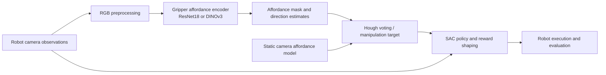
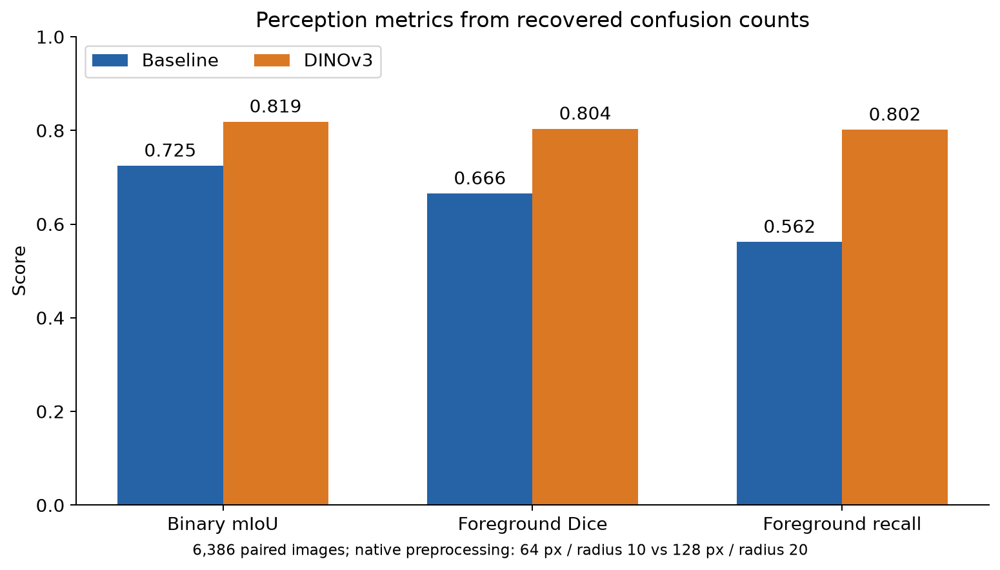
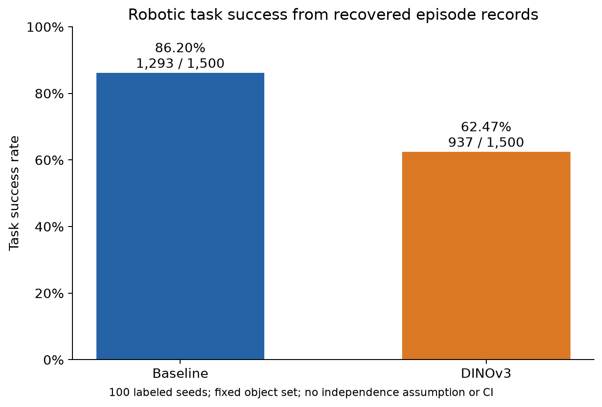

# VAPO + DINOv3: visual affordances for robotic manipulation

Research fork of [Visual Affordance-guided Policy Optimization (VAPO)](https://github.com/mees/vapo) developed during undergraduate research at UNICAMP. This project tests whether a DINOv3 visual encoder can improve VAPO's gripper-camera affordance estimates and, ultimately, robotic task success. The original VAPO method and code belong to its authors; this fork contributes the integration and evaluation tooling described below.

**Key finding checked against recovered experimental artifacts:** DINOv3 improved segmentation scores under native preprocessing, while robotic success fell from **86.20% to 62.47%**. Resolution and label radius differ between approaches, so this is not an isolated encoder comparison. This consolidation audits the researcher's completed experiments and recalculates their saved records. See the [artifact audit](docs/research-audit.md); no additional training or evaluation is required for this documentation work.

## What this fork adds

Compared with the last upstream commit in this Git history (`a0b9444`), this fork adds:

- A selectable DINOv3 gripper-camera affordance encoder and adapter (`vapo/affordance/Dinov3Adapter.py`, `vapo/affordance/affordance_model.py`).
- RGB preprocessing, 128-pixel affordance inputs, and an opt-in tabletop configuration that retains the existing 64-pixel SAC policy observation (`config/cfg_tabletop_dinov3.yaml`).
- Shape handling between affordance output, Hough voting, and policy input; an evaluation seed override and configuration loading that can preserve the selected affordance model.
- Observation diagnostics, deterministic replay checks, and compatibility tests. These check integration behavior; they are not scientific performance validation.
- A CPU analysis script with integrity checks, calculation tests, aggregate tables, source hashes, and figures derived from the recovered experimental records.

The [audit](docs/research-audit.md) maps the changes and evidence in more detail.

## Architecture



DINOv3 is integrated at the **gripper affordance encoder**, not as a replacement for the SAC policy or static-camera model. The DINOv3 path uses a frozen `dinov3_vits16plus` backbone in the checked-in configuration.

## Experimental results and interpretation

The following metrics were recalculated from **6,386 paired image records** and **3,000 robotic episode records**. [Aggregate results and provenance](docs/experiments/recovered/analysis_summary.json) include SHA-256 hashes of the four private source files. Raw CSVs, sample paths, datasets, and weights are not distributed here.

The four recovered split manifests reproduce the **same 6,386 validation sample IDs in the same order**, with no overlap with 133,528 training sample IDs. The [identity audit](docs/experiments/recovered/identity_audit.json) records manifest hashes and ordered-sample fingerprints. [Checkpoint identities](docs/experiments/recovered/checkpoints.sha256) record six recovered SHA-256 digests, including the shared SAC policy and DINOv3 backbone; these are supplied manifest identities, not a new local rehash of the weight files or proof of historical runtime contents.

| Perception metric | Baseline | DINOv3 |
| --- | ---: | ---: |
| Binary mIoU, global counts | 0.724985 | 0.819045 |
| Foreground Dice, global counts | 0.665553 | 0.803862 |
| Foreground recall, global counts | 0.562348 | 0.801815 |
| Recorded mean latency, ms | 3.682468 | 24.412255 |

The recovered setup uses **64 px / label radius 10** for baseline and **128 px / label radius 20** for DINOv3, on an **NVIDIA RTX A5500 with AMP enabled**, according to the recovered JSON. Global scores sum confusion counts within each model's native pixel grid. The evaluator measures synchronized **forward-only latency at batch size 1**, excluding data loading, device transfer, argmax, Hough voting and SAC. The supplied historical command is `python eval_affordance_dinov3_vs_baseline.py --warmup 5 --amp`: its five warmup iterations override the source default of 20, and AMP agrees with the summary. This command is supported by a recovered text record and code review, without a contemporaneous execution trace; timings remain descriptive native-pipeline measurements.



| Robotic evaluation | Successes / episodes | Success rate |
| --- | ---: | ---: |
| Baseline | 1,293 / 1,500 | 86.20% |
| DINOv3 | 937 / 1,500 | 62.47% |



Both approaches contain 100 labeled seeds with the same 15 objects per seed. All **3,000 CSV rows match the 200 recovered run logs**, and all recorded exit statuses are zero. Hydra snapshots and the archived evaluator confirm requested seeds 0–99 and propagation into the environment configuration. Both approaches reference the same SAC policy path/name, now associated with a recorded SHA-256 identity; historical loaded bytes and identical physical starting states are not independently attested. The largest drops include `frying_pan_1` (100% to 8%) and `hammer_2` (87% to 3%). [All object results](docs/experiments/recovered/robotic_by_object.png) show smaller gains for some objects. Confidence intervals are omitted by default because independent training repetitions and all randomness sources are not established.

Here, baseline denotes the original **VAPO with ResNet18 affordances and reward shaping**. The recovered policy config enables affordance inputs, distance and reward densification. A separate saved policy named `baseline` disables those features, but the A/B runners select the `vapo` policy for both approaches.

The training log's `val_miou` is foreground IoU averaged over batches, whereas the table's binary mIoU averages foreground and background IoUs from global counts. [Metric definitions and empty-mask conventions](docs/experimental-reproduction.md#metric-definitions) explain the numerical difference.

## Research Hypotheses and Future Experiments

The initial hypothesis was that DINOv3 could improve affordance perception and robotic manipulation while keeping the pretrained SAC policy fixed. The segmentation gains and lower task success above motivated three further hypotheses. The comparison does not isolate an encoder effect: input resolution, channels, decoder structure and affordance-label parameters also differ.

- **Observation distribution shift.** Masks and derived spatial cues may differ from those seen during SAC training, even when segmentation scores improve, making them less useful to the existing policy.
- **Policy adaptation.** Affordances may provide coarse spatial guidance while SAC supplies the fine control needed for manipulation. Adapting the policy to DINOv3 observations could therefore matter more than improving segmentation alone.
- **Localization quality.** Better mask overlap need not yield a better manipulation point. Errors in Hough-voted centers or their conversion from 2D pixels to 3D coordinates could impair execution.

Proposed controlled ablations would compare predicted and ground-truth masks, estimated and ground-truth centers, and frozen versus adapted SAC policies. Each comparison would hold the other pipeline stages, observation settings and evaluation conditions fixed, with centers expressed in consistent coordinate frames. Policy retraining or fine-tuning on DINOv3 observations using simulated data is a proposed next experiment; real-data adaptation and real-robot evaluation are further possible extensions.

These explanations remain unconfirmed. The ablations, SAC adaptation and real-robot experiments described here are proposals, not completed work or requirements for the current artifact audit.

## Reproduction

### Level 1: integration checks

The recovered results can be recalculated on CPU using Python's standard library, without model dependencies or weights:

```bash
python scripts/analyze_recovered_results.py --input-dir /path/to/private/recovered-files --output-dir /path/to/derived-results
```

To generate the figures, install `requirements-analysis.txt` and add `--plots`. See [analysis reproduction](docs/experimental-reproduction.md) for the four required files, formulas, outputs, and tested environment.

The supplementary [provenance audit](docs/experiments/recovered/provenance_audit.json) checks the private archive's logs, 400 Hydra files, commits and checkpoint references. Run `scripts/audit_recovered_provenance.py --help` for its configurable paths.

The standard-library script `scripts/audit_experiment_identity.py` additionally checks the six recorded checkpoint hashes, all four split manifests and the supplied command without loading weights or executing model code. See [audit instructions](docs/experimental-reproduction.md#checkpoint-split-and-command-evidence).

The project targets the original VAPO Linux/CUDA environment. Follow [local setup](docs/local_setup.md) or [Docker setup](docs/docker_setup.md), then install dependencies and run:

```bash
python -m pytest tests -q
```

The new calculation tests run independently of the research environment: `python -m pytest tests/test_recovered_results_analysis.py -q`. Some existing integration tests require project dependencies, DINOv3 weights, and trained checkpoints, and skip without them. Mock-based tests validate component contracts only; see the [audit](docs/research-audit.md#verification) for the actual test outcome.

### Level 2: full experiments

The following entry points are retained as reference for the research workflow. This consolidation reviews completed experiments and does not execute or require new training or evaluation. The affordance training entry point is:

```bash
export VAPO_ROOT="$PWD"
export DINOV3_REPO_DIR=/path/to/dinov3
export DINOV3_WEIGHTS_PATH=/path/to/authorized/dinov3_vits16plus.pth
python ./scripts/train_affordance.py dataset_name=simulation dataset.cam=gripper model_name=aff_gripper_dinov3
```

The checked-in `config/cfg_affordance.yaml` sets 50 epochs, `batch_size=2`, mixed precision, and GPU training. It saves validation checkpoints under the Hydra run directory. [Original data download instructions](docs/upstream-readme.md#download-the-playdata) describe the upstream simulation dataset (37.7 GB). Historical DINOv3 training config/overrides, split manifests and recorded checkpoint hashes are recovered. Raw image/label contents and the exact dataset release remain unattested. The training console records the best checkpoint at epoch 28 with `val_miou=0.72213`, consistent with the reconstructed training convention.

To evaluate a trained tabletop policy with an opt-in DINOv3 gripper affordance model:

```bash
export VAPO_GRIPPER_DINOV3_CKPT=/path/to/gripper_affordance.ckpt
python ./scripts/eval_tabletop.py --config-name cfg_tabletop_dinov3 \
  test.folder_name=/path/to/policy-run \
  test.model_name=most_tasks_from_15 \
  test.eval_seed=0
```

The policy run contains `.hydra/config.yaml` and references `trained_models/most_tasks_from_15.pth`; the static-camera checkpoint and simulator assets are additional inputs. `test.eval_seed=0` illustrates one of the recovered sweep's seeds 0–99. The evaluation uses the saved SAC policy configuration with the current gripper affordance selection. These reference commands are not new executions or evidence beyond the recovered records.

For single-observation diagnostics, see `scripts/validate_affordance_observation_sim.py` and `scripts/real_world/validate_affordance_observation.py`.

The recovered [perception evaluator](scripts/eval_affordance_dinov3_vs_baseline.py) is preserved verbatim after source review. [Reproduction notes](docs/experimental-reproduction.md#recovered-provenance-package) document its arguments, timing protocol, recovered environment versions, and remaining missing inputs. It was not executed during this consolidation.

## Provenance limits

The recovered hashes identify reported weight artifacts; they do not independently certify the bytes loaded during the historical executions. Split sample identity/order is verified, while raw image/label content hashes and a dataset release identifier remain unavailable. The recorded command is code-compatible but lacks a contemporaneous execution trace. Training-seed assignment, control of all RNG streams and paired physical initial states are not established. These limits are documented without making repeated experiments a completion requirement.

According to the supplied search record, real comparative segmentation images were not found in `reproduction/`, the project under the searched filename patterns, or `/tmp/vapo_ab`. No synthetic inference examples have been added. The figures above are derived from saved numerical records.

## Attribution and license

VAPO and its [ICRA 2022 paper](https://arxiv.org/abs/2203.00352) are by Jessica Borja-Diaz, Oier Mees, Gabriel Kalweit, Lukas Hermann, Joschka Boedecker, and Wolfram Burgard. The [original README](docs/upstream-readme.md) retains their installation, training, citation, and project details. The VAPO repository is [MIT licensed](LICENSE), with its copyright notice preserved. [DINOv3](https://github.com/facebookresearch/dinov3) is by Meta and has a [separate license](https://github.com/facebookresearch/dinov3/blob/main/LICENSE.md); obtain its code and weights under those terms. No DINOv3 weights are distributed here.
