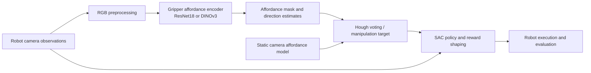

# VAPO + DINOv3: visual affordances for robotic manipulation

Research fork of [Visual Affordance-guided Policy Optimization (VAPO)](https://github.com/mees/vapo) developed during undergraduate research at UNICAMP. This project tests whether a DINOv3 visual encoder can improve VAPO's gripper-camera affordance estimates and, ultimately, robotic task success. The original VAPO method and code belong to its authors; this fork contributes the integration and evaluation tooling described below.

**Key finding checked against recovered experimental artifacts:** DINOv3 improved segmentation scores under native preprocessing, while robotic success fell from **86.20% to 62.47%**. Resolution and label radius differ between approaches, so this is not an isolated encoder comparison. The CSV calculations have been reproduced; training, inference, and robotic evaluation have not been rerun. See the [artifact audit](docs/research-audit.md).

## What this fork adds

Compared with the last upstream commit in this Git history (`a0b9444`), this fork adds:

- A selectable DINOv3 gripper-camera affordance encoder and adapter (`vapo/affordance/Dinov3Adapter.py`, `vapo/affordance/affordance_model.py`).
- RGB preprocessing, 128-pixel affordance inputs, and an opt-in tabletop configuration that retains the existing 64-pixel SAC policy observation (`config/cfg_tabletop_dinov3.yaml`).
- Shape handling between affordance output, Hough voting, and policy input; an evaluation seed override and configuration loading that can preserve the selected affordance model.
- Observation diagnostics, deterministic replay checks, and compatibility tests. These check integration behavior; they are not scientific performance validation.
- A CPU analysis script with integrity checks, calculation tests, aggregate tables, source hashes, and figures derived from the recovered experimental records.

The [audit](docs/research-audit.md) maps the changes and evidence in more detail.

## Architecture



DINOv3 is integrated at the **gripper affordance encoder**, not as a replacement for the SAC policy or static-camera model. The DINOv3 path uses a frozen `dinov3_vits16plus` backbone in the checked-in configuration.

## Experimental results and interpretation

The following metrics were recalculated from **6,386 paired image records** and **3,000 robotic episode records**. [Aggregate results and provenance](docs/experiments/recovered/analysis_summary.json) include SHA-256 hashes of the four private source files. Raw CSVs, sample paths, datasets, and weights are not distributed here.

| Perception metric | Baseline | DINOv3 |
| --- | ---: | ---: |
| Binary mIoU, global counts | 0.724985 | 0.819045 |
| Foreground Dice, global counts | 0.665553 | 0.803862 |
| Foreground recall, global counts | 0.562348 | 0.801815 |
| Recorded mean latency, ms | 3.682468 | 24.412255 |

The recovered setup uses **64 px / label radius 10** for baseline and **128 px / label radius 20** for DINOv3, on an **NVIDIA RTX A5500 with AMP enabled**, according to the recovered JSON. Global scores sum confusion counts within each model's native pixel grid. The recovered evaluator measures synchronized **forward-only latency at batch size 1**, excluding data loading, device transfer, argmax, Hough voting and SAC. Its default warmup is 20 iterations; the exact historical invocation is missing, so timings remain descriptive rather than a controlled encoder benchmark.


| Robotic evaluation | Successes / episodes | Success rate |
| --- | ---: | ---: |
| Baseline | 1,293 / 1,500 | 86.20% |
| DINOv3 | 937 / 1,500 | 62.47% |


Both approaches contain 100 labeled seeds with the same 15 objects per seed. All **3,000 CSV rows match the 200 recovered run logs**, and all recorded exit statuses are zero. Hydra snapshots and the archived evaluator confirm requested seeds 0–99 and propagation into the environment configuration. Both approaches reference the same SAC policy path/name; weight hashes and identical physical starting states remain unverified. The largest drops include `frying_pan_1` (100% to 8%) and `hammer_2` (87% to 3%). [All object results](docs/experiments/recovered/robotic_by_object.png) show smaller gains for some objects. Confidence intervals are omitted by default because independent training repetitions and all randomness sources are not established.

Here, baseline denotes the original **VAPO with ResNet18 affordances and reward shaping**. The recovered policy config enables affordance inputs, distance and reward densification. A separate saved policy named `baseline` disables those features, but the A/B runners select the `vapo` policy for both approaches.

The segmentation gain did **not** translate to better task success under these recorded conditions. Encoder choice alone cannot be identified as the cause: checkpoint selection, training schedule, label construction, affordance settings, and policy compatibility still need matched evidence. The training log's `val_miou` is foreground IoU averaged over batches, whereas the table's binary mIoU averages foreground and background IoUs from global counts. [Metric definitions and empty-mask conventions](docs/experimental-reproduction.md#metric-definitions) explain the numerical difference.

## Reproduction

### Level 1: integration checks

The recovered results can be recalculated on CPU using Python's standard library, without model dependencies or weights:

```bash
python scripts/analyze_recovered_results.py --input-dir /path/to/private/recovered-files --output-dir /path/to/derived-results
```

To generate the figures, install `requirements-analysis.txt` and add `--plots`. See [analysis reproduction](docs/experimental-reproduction.md) for the four required files, formulas, outputs, and tested environment.

The supplementary [provenance audit](docs/experiments/recovered/provenance_audit.json) checks the private archive's logs, 400 Hydra files, commits and checkpoint references. Run `scripts/audit_recovered_provenance.py --help` for its configurable paths.

The project targets the original VAPO Linux/CUDA environment. Follow [local setup](docs/local_setup.md) or [Docker setup](docs/docker_setup.md), then install dependencies and run:

```bash
python -m pytest tests -q
```

The new calculation tests run independently of the research environment: `python -m pytest tests/test_recovered_results_analysis.py -q`. Some existing integration tests require project dependencies, DINOv3 weights, and trained checkpoints, and skip without them. Mock-based tests validate component contracts only; see the [audit](docs/research-audit.md#verification) for the actual test outcome.

### Level 2: full experiments

For affordance training, provide the simulation playdata and DINOv3 code/weights, then use the configured training entry point:

```bash
export VAPO_ROOT="$PWD"
export DINOV3_REPO_DIR=/path/to/dinov3
export DINOV3_WEIGHTS_PATH=/path/to/authorized/dinov3_vits16plus.pth
python ./scripts/train_affordance.py dataset_name=simulation dataset.cam=gripper model_name=aff_gripper_dinov3
```

The checked-in `config/cfg_affordance.yaml` sets 50 epochs, `batch_size=2`, mixed precision, and GPU training. It saves validation checkpoints under the Hydra run directory. [Original data download instructions](docs/upstream-readme.md#download-the-playdata) describe the upstream simulation dataset (37.7 GB). These are entry-point templates, not verified commands for recreating the recovered run. Its historical DINOv3 training config/overrides are recovered; the dataset snapshot and checkpoint content hashes remain unavailable. The training console records the best checkpoint at epoch 28 with `val_miou=0.72213`, consistent with the reconstructed training convention.

To evaluate a trained tabletop policy with an opt-in DINOv3 gripper affordance model:

```bash
export VAPO_GRIPPER_DINOV3_CKPT=/path/to/gripper_affordance.ckpt
python ./scripts/eval_tabletop.py --config-name cfg_tabletop_dinov3 \
  test.folder_name=/path/to/policy-run \
  test.model_name=most_tasks_from_15 \
  test.eval_seed=0
```

The policy run must contain `.hydra/config.yaml` and `trained_models/most_tasks_from_15.pth`; the static-camera affordance checkpoint and simulator assets are also required. `test.eval_seed=0` is an example, **not** the verified seed of the reported 1,500-episode comparison. The evaluation uses the saved SAC policy configuration with the current gripper affordance selection. See [audit and reproduction gaps](docs/research-audit.md) before treating this as a reproduction of the reported result.

For single-observation diagnostics, see `scripts/validate_affordance_observation_sim.py` and `scripts/real_world/validate_affordance_observation.py`.

The recovered [perception evaluator](scripts/eval_affordance_dinov3_vs_baseline.py) is preserved verbatim after source review. [Reproduction notes](docs/experimental-reproduction.md#recovered-provenance-package) document its arguments, timing protocol, recovered environment versions, and remaining missing inputs. It was not executed during this consolidation.

## Limitations and next experiments

Recover checkpoint content hashes, the dataset/split manifest and exact perception invocation/warmup settings. The saved SAC policy config and DINOv3 training config/overrides are recovered alongside the runners, parser and per-seed CLI configs. The training folder name `gripper_seed0` does not establish an explicitly set training seed. Full RNG determinism, paired physical initial states and model execution still require verification. Center-selection diagnostics are available in the code, but recovered center-error measurements are missing. These remain hypotheses for the task-success gap. Real segmentation examples require paired source images, predictions, and permission to share them.

## Attribution and license

VAPO and its [ICRA 2022 paper](https://arxiv.org/abs/2203.00352) are by Jessica Borja-Diaz, Oier Mees, Gabriel Kalweit, Lukas Hermann, Joschka Boedecker, and Wolfram Burgard. The [original README](docs/upstream-readme.md) retains their installation, training, citation, and project details. The VAPO repository is [MIT licensed](LICENSE), with its copyright notice preserved. [DINOv3](https://github.com/facebookresearch/dinov3) is by Meta and has a [separate license](https://github.com/facebookresearch/dinov3/blob/main/LICENSE.md); obtain its code and weights under those terms. No DINOv3 weights are distributed here.
