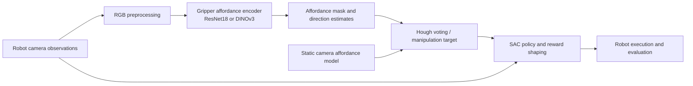

# VAPO + DINOv3: visual affordances for robotic manipulation

Research fork of [Visual Affordance-guided Policy Optimization (VAPO)](https://github.com/mees/vapo) developed during undergraduate research at UNICAMP. This project tests whether a DINOv3 visual encoder can improve VAPO's gripper-camera affordance estimates and, ultimately, robotic task success. The original VAPO method and code belong to its authors; this fork contributes the integration and evaluation tooling described below.

**Key finding reported by the researcher:** a perception comparison favored DINOv3, while a separate 1,500-episode-per-approach robotic comparison favored the original baseline (86.20% versus 62.47%). The exact comparison artifacts have not yet been located, so these figures are **researcher-reported, not independently verified from this repository**. See [evidence and limitations](docs/research-audit.md).

## What this fork adds

Compared with the last upstream commit in this Git history (`a0b9444`), this fork adds:

- A selectable DINOv3 gripper-camera affordance encoder and adapter (`vapo/affordance/Dinov3Adapter.py`, `vapo/affordance/affordance_model.py`).
- RGB preprocessing, 128-pixel affordance inputs, and an opt-in tabletop configuration that retains the existing 64-pixel SAC policy observation (`config/cfg_tabletop_dinov3.yaml`).
- Shape handling between affordance output, Hough voting, and policy input; an evaluation seed override and configuration loading that can preserve the selected affordance model.
- Observation diagnostics, deterministic replay checks, and compatibility tests. These check integration behavior; they are not scientific performance validation.

The [audit](docs/research-audit.md) maps the changes and evidence in more detail.

## Architecture



DINOv3 is integrated at the **gripper affordance encoder**, not as a replacement for the SAC policy or static-camera model. The DINOv3 path uses a frozen `dinov3_vits16plus` backbone in the checked-in configuration.

## Experimental results and interpretation

The following comparison values came from the research handoff. The underlying evaluation report, raw predictions, per-episode results, checkpoint identifiers, and timing protocol are still needed to verify them. A local DINOv3 training log confirms **6,386 validation samples**, but its logged `val_miou` values do **not** establish the reported binary mIoU of 0.8190; it may use a different metric or run.

| Perception metric | Baseline | DINOv3 | Status |
| --- | ---: | ---: | --- |
| Binary mIoU | 0.7250 | 0.8190 | Researcher-reported |
| Dice | 0.6656 | 0.8039 | Researcher-reported |
| Recall | 0.5623 | 0.8018 | Researcher-reported |
| Inference latency | ~3.68 ms | ~22 ms | Researcher-reported; hardware/protocol missing |

| Robotic evaluation | Successes / episodes | Success rate | Status |
| --- | ---: | ---: | --- |
| Baseline | 1,293 / 1,500 | 86.20% | Researcher-reported |
| DINOv3 | 937 / 1,500 | 62.47% | Researcher-reported |

The reported segmentation gain did **not** translate to better task success. Encoder choice alone cannot be identified as the cause: training schedule, input resolution, checkpoint selection, affordance settings, and policy compatibility must be matched and documented. The checked-in DINOv3 training configuration specifies 50 epochs and 128-pixel gripper inputs; the policy configuration uses 64-pixel observations.

## Reproduction

### Level 1: integration checks

The project targets the original VAPO Linux/CUDA environment. Follow [local setup](docs/local_setup.md) or [Docker setup](docs/docker_setup.md), then install dependencies and run:

```bash
python -m pytest tests -q
```

Some tests require the DINOv3 repository, licensed weights, and trained checkpoints; they skip when those paths are absent. Running the suite with mocks validates component contracts only. In the current Windows/Python 3.14 environment, the suite returned 2 passed and 7 skipped (`python -m pytest -p no:cacheprovider tests -q`); full integration checks remain unverified without the research dependencies.

### Level 2: full experiments

For affordance training, provide the simulation playdata and DINOv3 code/weights, then use the configured training entry point:

```bash
export VAPO_ROOT="$PWD"
export DINOV3_REPO_DIR=/path/to/dinov3
export DINOV3_WEIGHTS_PATH=/path/to/authorized/dinov3_vits16plus.pth
python ./scripts/train_affordance.py dataset_name=simulation dataset.cam=gripper model_name=aff_gripper_dinov3
```

The checked-in `config/cfg_affordance.yaml` sets 50 epochs, `batch_size=2`, mixed precision, and GPU training. It saves validation checkpoints under the Hydra run directory. [Original data download instructions](docs/upstream-readme.md#download-the-playdata) describe the upstream simulation dataset (37.7 GB). The exact dataset snapshot, seed, checkpoint, and GPU used for the reported comparison remain unrecorded.

To evaluate a trained tabletop policy with an opt-in DINOv3 gripper affordance model:

```bash
export VAPO_GRIPPER_DINOV3_CKPT=/path/to/gripper_affordance.ckpt
python ./scripts/eval_tabletop.py --config-name cfg_tabletop_dinov3 \
  test.folder_name=/path/to/policy-run \
  test.model_name=most_tasks_from_15 \
  test.eval_seed=0
```

The policy run must contain `.hydra/config.yaml` and `trained_models/most_tasks_from_15.pth`; the static-camera affordance checkpoint and simulator assets are also required. `test.eval_seed=0` is an example, **not** the verified seed of the reported 1,500-episode comparison. The evaluation uses the saved SAC policy configuration with the current gripper affordance selection. See [audit and reproduction gaps](docs/research-audit.md) before treating this as a reproduction of the reported result.

For single-observation diagnostics, see `scripts/validate_affordance_observation_sim.py` and `scripts/real_world/validate_affordance_observation.py`.

## Limitations and next experiments

Recover the raw evaluation artifacts and exact run configurations; compare both approaches with matched policy checkpoints, scene distributions, seeds, and affordance settings; then study whether mask calibration, target selection, or policy input distribution explains the task-success gap. Add real segmentation figures only when paired source images, predictions, and permissions are available.

## Attribution and license

VAPO and its [ICRA 2022 paper](https://arxiv.org/abs/2203.00352) are by Jessica Borja-Diaz, Oier Mees, Gabriel Kalweit, Lukas Hermann, Joschka Boedecker, and Wolfram Burgard. The [original README](docs/upstream-readme.md) retains their installation, training, citation, and project details. The VAPO repository is [MIT licensed](LICENSE), with its copyright notice preserved. [DINOv3](https://github.com/facebookresearch/dinov3) is by Meta and has a [separate license](https://github.com/facebookresearch/dinov3/blob/main/LICENSE.md); obtain its code and weights under those terms. No DINOv3 weights are distributed here.
